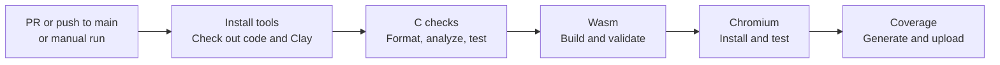

# clang-clay-wasm-example

A C17 template for the browser. Clang and LLD build freestanding WebAssembly without Emscripten or a C standard library. The example is a click counter: Clay computes the layout, and JavaScript renders it in the browser.

The template includes native C tests, a Chromium end-to-end test, formatting, static and dynamic analysis, and code coverage. Develop on Linux locally or in a Docker or Podman dev container. Use GNU Make directly, run `sh scripts/dev.sh`, or use the configured VS Code tasks.


## Prerequisites

> Note that this setup assumes you are using Debian/Ubuntu (Linux).

- Container Engine (required for dev container development)
    - Docker:
        ```sh
        curl -fsSL https://get.docker.com -o get-docker.sh
        sudo sh ./get-docker.sh --dry-run
        ```
    - Podman:
        ```sh
        sudo apt update && sudo apt install -y podman
        ```
- VS Code, go to `https://code.visualstudio.com/docs/setup/linux` and follow the instructions (Linux specific).
    - VS Code Extensions:
        - Dev Containers `https://marketplace.visualstudio.com/items?itemName=ms-vscode-remote.remote-containers`
            - NB! Make sure Dev containers plugin is pointing to Podman, if you are not using Docker. Check `$HOME/.config/Code/User/settings.json` (for Linux).
        - These already included inside the dev container:
            - C/C++ (GDB debug adapter) `https://marketplace.visualstudio.com/items?itemName=ms-vscode.cpptools`
            - clangd `https://marketplace.visualstudio.com/items?itemName=llvm-vs-code-extensions.vscode-clangd`
            - EditorConfig `https://marketplace.visualstudio.com/items?itemName=EditorConfig.EditorConfig`
            - C++ TestMate `https://marketplace.visualstudio.com/items?itemName=TestMate.vscode-catch2-test-adapter`
            - Coverage Gutters `https://marketplace.visualstudio.com/items?itemName=ryanluker.vscode-coverage-gutters`
            - Live Server `https://marketplace.visualstudio.com/items?itemName=ritwickdey.liveserver`    
- Chromium: `sudo apt install chromium` (application specific, for debugging)

> Run commands from project root folder (e.g. `sh scripts/dev.sh <command>`). From another directory, use an absolute paths.


## Environment Setup

### Dev container

In VS Code, run **Dev Containers: Reopen in Container** and select either the Docker or Podman configuration.

The container is configured to do everything needed to prepare the project.

You can skip **Local setup without a dev container** from here.


### Local setup without a dev container

This is the "manual" approach. Install the development dependencies:

```sh
sudo apt-get update
sudo apt-get install -y \
    locales sudo git make pkg-config \
    clang lld llvm wabt clangd-19 bear clang-format-19 editorconfig \
    gdb cppcheck clang-tidy valgrind libclang-rt-dev \
    libgtest-dev libgmock-dev lcov \
    webfs media-types curl util-linux ca-certificates
sudo apt-get install -y nodejs npm
```

> NB! Make sure you have Node 20+ (`nodejs`)

Prepare the project after installing the dependencies:

```sh
sh scripts/dev.sh prepare
```

This initializes the Clay submodule and generates `compile_commands.json`.
In VS Code, run **Tasks: Run Task** → **Prepare dependencies and compilation database** to do the same.


#### Generate the compilation database

> NB! No need to run this during the setup, the `sh script/dev.sh prepare`-command is sufficient.

Run this whenever you make changes to compiler flags, include paths, or compiled source files. Ordinary source edits do not require regeneration.

```sh
sh scripts/dev.sh compdb
```

Bear uses wrapper mode to capture the Clang driver without also recording its internal `-cc1` invocation. It captures the release build and writes `compile_commands.json` to the repository root.


## Build & Run

Build `release` or `debug`:

```sh
sh scripts/dev.sh build release  # or just: sh scripts/dev.sh build
sh scripts/dev.sh build debug
```

| Mode | Compiler and linker settings | Output directory |
| --- | --- | --- |
| Release (default) | `-Os -Wall -Wextra`, with debug information stripped | `src/build/release/` |
| Debug | `-O0 -g -Wall -Wextra -Wpedantic -Werror`, with debug information preserved | `src/build/debug/` |


### Validate and inspect WebAssembly

Use WABT to validate or inspect the release WebAssembly module. Both commands build it first if needed:

```sh
sh scripts/dev.sh validate
sh scripts/dev.sh inspect
```

For instruction-level disassembly:

```sh
wasm-objdump -d src/build/release/index.wasm
```

### Run (serve) the application

(Build and) serve the selected mode with webfsd:

```sh
sh scripts/dev.sh serve release  # or just: sh scripts/dev.sh serve
sh scripts/dev.sh serve debug
```

Then open a web browser and check `http://127.0.0.1:8080/`

The server stays in the foreground; use **Ctrl+C** to stop it before switching modes.

In VS Code, choose **Tasks: Run Task** → **Run (Serve) (Debug)** to build and serve the debug app without launching the debugger. Use **Stop (Debug)** to stop it.

#### Alternative, run (serve) with Live Server (VS Code extension)

**Live Server** (VS Code extension) serves the release build and reloads the page automatically when the served files change. It does not build the app.

1. In VS Code make sure you have the repository opened in its root folder.
2. Stop any running local server first, that uses port 8080. 
3. Build the release app with **Build (Release)**.
4. Run **Live Server: Open with Live Server** from the Command Palette, or click **Go Live** in the status bar.
    - If a browser doesn't open, visit `http://127.0.0.1:8080/`
5. After editing the C or web source, run the release build again to update the files that Live Server watches.
6. To stop serving, run **Live Server: Stop Live Server** or click the port indicator in the status bar.


## Stop & Clean

To stop the standalone server, use **Tasks: Run Task** → **Stop (Serve)** or run:
```sh
sh scripts/dev.sh stop
```

Prefer **Ctrl+C** in the serving terminal if other `webfsd` instances are running: when no valid PID file is found, the stop command falls back to scanning for `webfsd` processes. For the **Run (Serve) (Debug)** task, use **Stop (Debug)**.

Clean build artifacts:
```sh
sh scripts/dev.sh clean
```


## Debug (in VS Code)

### Debug the native C tests and code they call

In **Run and Debug**, select **Debug Native Tests (GDB)** and press **F5**. The **Build (Native Tests)** task builds `src/build/test/native_tests` with debug symbols without running it first. GDB then launches it.

You can set breakpoints in `tests/unit/counter_test.c` and `src/counter.c` to step through the test and the production code it calls.

No web server or browser is needed. The dev containers include GDB and the C/C++ (debug adapter) (clangd remains the editor's language server).


### Debug the browser app

> Before continuing make sure to have nothing running or stop anything using port 8080

In **Run and Debug**, select **Debug WebAssembly (Chromium)** and press **F5**

You will have a debug session with Chromium. To see more debug information, in Chromium press **Ctrl+Shift+I**. You set breakpoints as usual in VS Code.


## Testing and code quality

### Test suites

Start with the [native suite](#native-unit-and-integration-tests) for C logic and layout changes. Use the [browser suite](#browser-end-to-end-test) to check the built Wasm app and JavaScript renderer together.

#### Native unit and integration tests

```sh
sh scripts/dev.sh test native
```

The native suite runs both tests (unit test and integration test) in one executable, with its entry point in [`tests/native_main.c`](tests/native_main.c).

- [`tests/unit/`](tests/unit/) checks the counter logic in isolation with plain C assertions.
- [`tests/integration/`](tests/integration/) exercises the app's frame code with real Clay layout. Its text-measurement callback is a stub: it returns predictable dimensions without verifying calls.

#### Browser end-to-end test

Install the Node dependencies and Playwright Chromium once for both browser testing and coverage (available in the dev container):

```sh
npm ci --prefix tests
npm exec --prefix tests -- playwright-core install --with-deps --only-shell chromium
```

And run test:

```sh
sh scripts/dev.sh test browser
```

The scenario and its runner live in [`tests/end-to-end/`](tests/end-to-end/). The runner serves the release HTML and Wasm on a temporary loopback port and checks that pointer clicks update the displayed counter in headless Chromium. It exits without producing a coverage report.

If you already have a compatible Chromium and its system libraries, skip the browser install and set `CHROMIUM` to its executable path for `test browser` or `coverage`, for example:

```sh
CHROMIUM=/usr/bin/chromium sh scripts/dev.sh test browser
CHROMIUM=/usr/bin/chromium sh scripts/dev.sh coverage
```

You can use `command -v chromium` to find the executable path (Todo: figure out if you do this only in the container, or connect chromium on host side?)


### Dynamic analysis

These modes run the same native tests with runtime checks for memory errors and undefined behavior:

```sh
sh scripts/dev.sh test native valgrind
sh scripts/dev.sh test native sanitize
```

- **Valgrind Memcheck** runs the regular native test binary with debug symbols. Memory errors and definite or possible leaks fail the run; still-reachable allocations are reported without failing it.
- **Clang sanitizers** build a separate binary in `src/build/sanitize/` with AddressSanitizer and UndefinedBehaviorSanitizer. Leak detection is enabled on Linux. Findings fail the run, and `llvm-symbolizer` resolves stack frames to source locations.

These checks cover only the native C paths the tests execute, not the browser's WebAssembly or JavaScript renderer.

### Static analysis

Initialize the Clay submodule first; this command does not require a generated `compile_commands.json`.

```sh
sh scripts/dev.sh analyze
```

With no tool arguments, `analyze` runs all three tools: **Clang Static Analyzer** (`clang --analyze`), **clang-tidy** (bug-prone checks configured in `.clang-tidy`), and **cppcheck** (errors plus warning, performance, and portability checks). No executable is produced or run. Diagnostics selected by these checks fail the command.

To run only selected tools, pass one or more names: `clang` (Clang Static Analyzer), `clang-tidy`, or `cppcheck`. For example:

```sh
sh scripts/dev.sh analyze # Same as: sh scripts/dev.sh analyze clang clang-tidy cppcheck
sh scripts/dev.sh analyze clang
sh scripts/dev.sh analyze clang-tidy
sh scripts/dev.sh analyze cppcheck
sh scripts/dev.sh analyze clang clang-tidy
sh scripts/dev.sh analyze clang cppcheck
sh scripts/dev.sh analyze clang-tidy cppcheck
sh scripts/dev.sh analyze clang cppcheck
```

To continue with the other tools after a failure, run `make -k -C src analyze` (this tells `make` to keep going with the remaining tools).

The workflow checks the application C sources and native C tests. The Clang tools use the WebAssembly compiler flags for the application and native flags for the tests. Cppcheck uses its native platform model and excludes diagnostics located in the vendored Clay headers.

### Code coverage

```sh
sh scripts/dev.sh coverage
```

Coverage reruns the native and browser suites with instrumentation; it is not a separate suite. [`tests/coverage/`](tests/coverage/) contains the browser instrumentation and reporting script, which reuses the end-to-end scenario. Native coverage objects rebuild automatically if the Clang toolchain or checkout path changes.

| Coverage | Files | How it is measured |
| --- | --- | --- |
| Native C | `src/main.c`, `src/counter.c` | [Clang source-based coverage](https://clang.llvm.org/docs/SourceBasedCodeCoverage.html) from the native tests. |
| Browser JavaScript | Script in `src/web/index.html` | Istanbul coverage from the Chromium counter test, which sends real clicks and advances frames with Playwright's test clock. |

The browser test runs the real Wasm app, but the Wasm binary is not instrumented. Coverage excludes Clay, tests, build scripts, HTML markup, and CSS. There is no percentage gate.

#### View the combined report

- **Browser:** Open `src/build/coverage/html/index.html` for line and branch coverage
- **VS Code:** Run **Code Coverage**, then open the Command Palette (**Ctrl+Shift+P**) and select **Coverage Gutters: Watch**
- **Editors and CI:** Read `src/build/coverage/lcov.info`

### Formatting

```sh
sh scripts/dev.sh format       # rewrite tracked C sources and headers
sh scripts/dev.sh format-check # report formatting differences without editing
```

Both commands use clang-format 19 and the root `.clang-format`. They skip the Clay submodule, untracked files, and generated build outputs. Stage new C files to include them in the check. Use `format-check` in CI.

VS Code formats C on save through clangd 19. The EditorConfig extension applies the root `.editorconfig` whitespace rules for all supported file types. The optional `editorconfig` CLI reports the resolved rules for a path; it does not lint or format files.

## Command reference

These are equivalent ways to run the same workflows.

| Workflow | VS Code / Dev Container entrypoint | Portable script command | Equivalent underlying command |
| --- | --- | --- | --- |
| Prepare dependencies and compilation database | **Tasks: Run Task** → **Prepare (dependencies and compilation database)**; also runs automatically on every Docker or Podman dev container start | `sh scripts/dev.sh prepare` | `make -C src prepare` (initialize submodules, then run `compdb`) |
| Regenerate compilation database | **Tasks: Run Task** → **Generate compilation database** | `sh scripts/dev.sh compdb` | `make -C src compdb` |
| Validate WebAssembly | **Tasks: Run Task** → **Validate WebAssembly** | `sh scripts/dev.sh validate` | `make -C src validate` |
| Inspect WebAssembly | **Tasks: Run Task** → **Inspect WebAssembly** | `sh scripts/dev.sh inspect` | `make -C src inspect` |
| Build release | **Tasks: Run Build Task** → **Build (Release)** | `sh scripts/dev.sh build release` | `make -C src release` (also the default target) |
| Build debug | **Tasks: Run Task** → **Build (Debug)** | `sh scripts/dev.sh build debug` | `make -C src debug` |
| Rebuild release | **Tasks: Run Task** → **Rebuild (Release)** | `sh scripts/dev.sh rebuild release` | `make -C src rebuild-release` (also `make -C src rebuild`) |
| Rebuild debug | **Tasks: Run Task** → **Rebuild (Debug)** | `sh scripts/dev.sh rebuild debug` | `make -C src rebuild-debug` |
| Clean | **Tasks: Run Task** → **Clean** | `sh scripts/dev.sh clean` | `make -C src clean` |
| Build and serve release | **Tasks: Run Task** → **Run (Serve) (Release)** | `sh scripts/dev.sh serve release` | `make -C src serve MODE=release` (also `make -C src serve`) |
| Build and serve debug | **Tasks: Run Task** → **Run (Serve) (Debug)** | `sh scripts/dev.sh serve debug` | `make -C src serve MODE=debug` |
| Stop the standalone server | **Tasks: Run Task** → **Stop (Serve)** | `sh scripts/dev.sh stop` | `make -C src stop` |
| Build native tests without running them | **Tasks: Run Task** → **Build (Native Tests)** | — | `make -C src build/test/native_tests` |
| Run native tests | **Tasks: Run Test Task** → **Test (Native)** | `sh scripts/dev.sh test native` | `make -C src test-native` |
| Run native tests under Memcheck | **Tasks: Run Task** → **Test (Native: Valgrind)** | `sh scripts/dev.sh test native valgrind` | `make -C src test-native-valgrind` |
| Run native tests with Clang sanitizers | **Tasks: Run Task** → **Test (Native: Sanitizers)** | `sh scripts/dev.sh test native sanitize` | `make -C src test-native-sanitize` |
| Run browser test | **Tasks: Run Task** → **Test (Browser)** | `sh scripts/dev.sh test browser` | `make -C src test-browser` |
| Run all static analyzers | **Tasks: Run Task** → **Analyze (clang-tidy, Clang Static Analyzer, cppcheck)** | `sh scripts/dev.sh analyze` | `make -C src analyze` |
| Run Clang Static Analyzer only | **Tasks: Run Task** → **Analyze (Clang Static Analyzer)** | `sh scripts/dev.sh analyze clang` | `make -C src analyze-clang` |
| Run clang-tidy only | **Tasks: Run Task** → **Analyze (clang-tidy)** | `sh scripts/dev.sh analyze clang-tidy` | `make -C src analyze-clang-tidy` |
| Run cppcheck only | **Tasks: Run Task** → **Analyze (cppcheck)** | `sh scripts/dev.sh analyze cppcheck` | `make -C src analyze-cppcheck` |
| Run a combination of static analyzers | Pass tool names in the integrated terminal | (example) `sh scripts/dev.sh analyze clang-tidy cppcheck` | `make -C src analyze-clang-tidy analyze-cppcheck` |
| Generate code coverage | **Tasks: Run Task** → **Code Coverage** | `sh scripts/dev.sh coverage` | `make -C src coverage` |
| Format tracked C files | **Tasks: Run Task** → **Format (formats C files)** | `sh scripts/dev.sh format` | `clang-format-19 -i` on tracked `.c` and `.h` files |
| Check tracked C formatting | **Tasks: Run Task** → **Format (Checks C files)** | `sh scripts/dev.sh format-check` | `clang-format-19 --dry-run --Werror` on the same files |
| Show command help | No dedicated task; run the script in the integrated terminal | `sh scripts/dev.sh help` | Prints the script's usage information; no build command |


## Development Tools Overview

This table covers the tools and libraries used by the project's development workflows, plus optional development tools provided by the dev containers. The setup instructions and Dockerfiles list the supporting system packages.

| Tool type | Tools | Purpose |
| --- | --- | --- |
| Development environment | Debian dev containers (Docker or Podman) | Provide a consistent development environment. |
| IDE/Editor and container integration | VS Code and Dev Containers | Run development tasks and debuggers locally or in a dev container. |
| Version control | Git | Manages the Clay submodule and identifies tracked C files for formatting. |
| Build system and workflow entry points | GNU Make and `scripts/dev.sh` (POSIX shell) | The Makefile defines build, serve, and test workflows; the script provides a common entry point for the terminal and VS Code. |
| Compiler and linker | Clang and LLD (`wasm-ld`) | Clang compiles the native tests; Clang and LLD build the freestanding Wasm app. |
| UI layout | Clay | Computes the app's layout and render commands; pinned as a Git submodule. |
| Compilation database and language server | Bear and clangd 19 | Bear records build commands in `compile_commands.json`; clangd uses them for editor completion, diagnostics, and navigation. |
| WebAssembly tooling | WABT (`wasm-validate`, `wasm-objdump`) | Validates, inspects, and disassembles the Wasm binary. |
| Browser debugging | VS Code JavaScript Debugger, WebAssembly DWARF Debugging extension, and Chromium | Debug JavaScript and step through the original C source in the Wasm debug build. |
| Native debugger | GDB and the VS Code C/C++ debug adapter | Debug the native test executable, including the production C code it calls. |
| Unit and integration testing | C `assert` | Checks counter behavior and its integration with the Clay frame code. |
| JavaScript test tooling | Node.js 20+ and npm | Run the browser test and coverage scripts and install their locked dependencies. |
| Browser end-to-end testing | Playwright and Chromium | Run the browser end-to-end test against the Wasm application. |
| Optional C++ test tooling | Google Test, Google Mock, and C++ TestMate | Available in the dev containers for projects that need a C++ test framework, interaction verification with mocks, or editor test discovery. The current suite uses none of these. |
| Dynamic analysis | Valgrind Memcheck | Checks native execution for memory errors and leaks. |
| Dynamic analysis | Clang ASan, LeakSanitizer, UBSan, and `llvm-symbolizer` | Detect memory errors, leaks on Linux, and undefined behavior in native tests; resolve stack traces to source locations. |
| Static analysis | Clang Static Analyzer, clang-tidy, and cppcheck | Check C source without running it. The project calls the analyzer through `clang --analyze`; the dev containers also provide `scan-build-19`. |
| Native code coverage | `llvm-profdata` and `llvm-cov` | Merge native coverage profiles, summarize coverage, and export an LCOV tracefile. |
| JavaScript code coverage | Istanbul | Instruments the browser's JavaScript renderer and exports an LCOV tracefile. |
| Coverage reporting and visualization | LCOV `genhtml` and Coverage Gutters | Render the combined coverage report as HTML and show coverage in VS Code, respectively. |
| Formatting and editor conventions | clang-format 19 and EditorConfig | Apply C formatting and editor whitespace conventions, respectively. |
| Static web server and MIME types | `webfsd` (webfs package) and media-types | Serve the built application with the WebAssembly MIME type. |
| Debug server readiness | curl and `flock` (util-linux) | Check that the supervised server serves the debug build and coordinate its start and stop. |
| Static web server | Live Server | Optional VS Code alternative for serving the release build. |

## Pipeline

The [GitHub Actions workflow](.github/workflows/ci.yml) uses the same Debian base as the dev containers. It reuses the Makefile and `scripts/dev.sh` commands described above, so the checks can also run locally.

The `Verify` job runs these stages in order and skips later steps after a failure.



CI does not release, deploy, or publish the application. To gate merges on CI, require the `Verify` check in the branch rules for `main` after the first hosted run.

### Find results on GitHub

1. In the repository, open **Actions → CI** and select the run for the commit or pull request you want to inspect. From a pull request, you can also open **Checks** and select **Verify**.
2. On the run page, open **Jobs → Verify** and expand the relevant step. Formatting, analyzer, and Wasm diagnostics are in their respective step logs. **Run native unit and integration tests** includes normal test output, Valgrind, and sanitizer diagnostics. **Run Chromium end-to-end test** shows browser test output. There is no separate test report. To save the logs, use the gear menu above the log and select **Download log archive**.
3. **Generate native and browser coverage** prints the line and branch totals. For the detailed report, return to the run **Summary** and download **Artifacts → coverage**. Extract the ZIP and open `html/index.html` in a browser, or import `lcov.info` into a coverage tool. The artifact is retained for 14 days and is only available if the upload step succeeded. There is no coverage threshold.

### Find results from the terminal

Install the [GitHub CLI (`gh`)](https://cli.github.com/). In a terminal, change into the repository folder (the one containing this README). If you haven't signed in to `gh` yet, run `gh auth login`.

List recent runs of the `CI` workflow:

```sh
gh run list --workflow CI
```

Find the row for the run you want and copy the number in its `ID` column. In the example below, replace `1234567890` with that number. Run the log or download command you need:

```sh
run_id=1234567890
gh run view "$run_id" --log           # Full log
gh run view "$run_id" --log-failed    # Failed steps only
gh run download "$run_id" --name coverage --dir ./coverage-report
```

After downloading coverage, open `coverage-report/html/index.html` in your browser.


## License

MIT License, see `LICENSE` for details.

